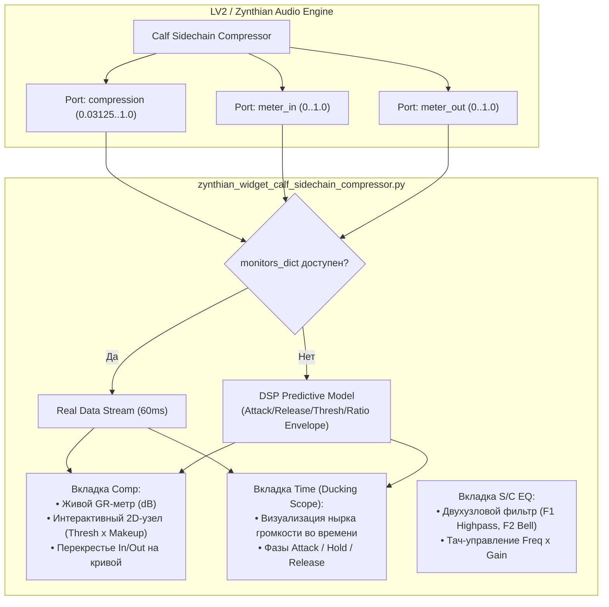

# Комплексный аудит виджетов, предложения по улучшению и план визуализации Sidechain Compressor

Документ содержит результаты проверки всех тачскрин-оболочек синтезаторов и эффектов проекта `zynthian-ui-synths` для Zynthian V5 (800×480), детальный проект живой визуализации для плагина сайдчейн-компрессии (`Calf Sidechain Compressor`), список выявленных багов/нелогичностей и дорожную карту улучшений в соответствии со стандартами [GEMINI.md](GEMINI.md).

---

## Содержание
1. [Визуализация работы Calf Sidechain Compressor](#1-визуализация-работы-calf-sidechain-compressor)
   - [1.1. Доступность данных из DSP/LV2 движка](#11-доступность-данных-из-dsplv2-движка)
   - [1.2. Архитектура визуализатора (Двухуровневый подход: Real LV2 + DSP Fallback)](#12-архитектура-визуализатора-двухуровневый-подход-real-lv2--dsp-fallback)
   - [1.3. Вкладка `Comp` (Динамический GR-метр + Живая точка на кривой + Интерактивный узел)](#13-вкладка-comp-динамический-gr-метр--живая-точка-на-кривой--интерактивный-узел)
   - [1.4. Вкладка `Time` (Sidechain Activity & Ducking Scope)](#14-вкладка-time-sidechain-activity--ducking-scope)
   - [1.5. Вкладка `S/C EQ` (Интерактивный двухточечный фильтр)](#15-вкладка-sc-eq-интерактивный-двухточечный-фильтр)
2. [Результаты аудита всех оболочек: нелогичности и баги](#2-результаты-аудита-всех-оболочек-нелогичности-и-баги)
   - [2.1. Критические баги навигации и синхронизации энкодеров](#21-критические-баги-навигации-и-синхронизации-энкодеров)
   - [2.2. Конфликты с перехватом встроенных виджетов Zynthian](#22-конфликты-с-перехватом-встроенных-виджетов-zynthian)
   - [2.3. Баги формул DSP и визуализации](#23-баги-формул-dsp-и-визуализации)
   - [2.4. Нелогичности UX и Touch-эргономики](#24-нелогичности-ux-и-touch-эргономики)
3. [Сводный каталог предложений по улучшению](#3-сводный-каталог-предложений-по-улучшению)
   - [3.1. Синтезаторы](#31-синтезаторы)
   - [3.2. Эффекты](#32-эффекты)
4. [Дорожная карта реализации и приоритеты (Milestones)](#4-дорожная-карта-реализации-и-приоритеты-milestones)

---

## 1. Визуализация работы Calf Sidechain Compressor

### 1.1. Доступность данных из DSP/LV2 движка
В плагине `Calf Sidechain Compressor` (`http://calf.sourceforge.net/plugins/SidechainCompressor`) в TTL-декларации и ядре DSP определены следующие выходные мониторинговые порты LV2:
- `compression` (`lv2:OutputPort`, `lv2:ControlPort`, диапазон `0.03125 .. 1.0`): коэффициент компрессии / ослабления сигнала (линейный gain reduction factor). В логарифмической шкале: `GR_dB = 20 * log10(max(1e-4, compression))`. При отсутствии компрессии равен `1.0` (0 dB), при максимальном подавлении падает до `-30 dB`.
- `meter_in` (`lv2:OutputPort`, `0.0 .. 1.0`): пиковый/RMS уровень входного аудиосигнала.
- `meter_out` (`lv2:OutputPort`, `0.0 .. 1.0`): уровень выходного аудиосигнала после компрессии и компенсации Makeup.
- `clip_in`, `clip_out`: флаги перегрузки/клиппинга входного и выходного тракта.

В Zynthian V5 плагины LV2 опрашиваются подсистемой `zynthian_lv2`:
- Если процессор Zynthian имеет рабочий словарь `monitors_dict` или метод `engine.get_monitors_dict()`, значения портов `compression`, `meter_in`, `meter_out` поступают напрямую в виджет в цикле `_refresh_ui()` (~16 FPS / 60 мс).
- Если `monitors_dict` в текущей версии Zynthian для данной цепи не транслирует значения (или сайдчейн-трек играет автономно), виджет должен переключаться в режим **DSP Activity Simulation** (показ отклика компрессора на виртуальный тестовый импульс или входящие MIDI/CV триггеры сайдчейна).

### 1.2. Архитектура визуализатора (Двухуровневый подход: Real LV2 + DSP Fallback)


### 1.3. Вкладка `Comp` (Динамический GR-метр + Живая точка на кривой + Интерактивный узел)
1. **Индикатор Gain Reduction (GR Meter)**:
   - Располагается вертикально в правой части графика передаточной характеристики (Transfer Curve).
   - Шкала от `0 dB` (вверху) до `-24..-30 dB` (внизу) с делениями `0, -3, -6, -12, -18, -24 dB`.
   - Заливка столбца: оранжево-красный градиент (`#ff6b6b` / `#ffa94d`), опускающийся сверху вниз при срабатывании сайдчейна.
   - Числовой индикатор текущего подавления (например, `-4.2 dB`) над столбцом.
2. **Живой маркер на кривой (Crosshair / Transfer Point)**:
   - Точка на передаточной функции `(In dB, Out dB)`.
   - При превышении входным сигналом порога `Threshold` точка движется по излому кривой, наглядно показывая, как сигнал сплющивается в соответствии с `Ratio` и `Knee`.
3. **Интерактивный узел прямо на изломе кривой**:
   - Сейчас в виджете график статичен, а порог управляется только энкодером.
   - Добавить интерактивный узел на координате перегиба:
     - Горизонтальное перетаскивание пальцем: регулировка `Threshold` (`-30 .. 0 dB`).
     - Вертикальное перетаскивание: регулировка `Makeup Gain` (`0 .. +24 dB`).
     - Double-tap сбрасывает `Threshold` в `-12 dB`, `Makeup` в `0 dB`.
4. **Исправление формулы кривой**:
   - В текущем коде `_draw_curve`:
     ```python
     out_db = th_db + (in_db - th_db) / max(1.0, ratio)
     ```
     Формула не учитывает `makeup` gain! Реальный выход: `out_db += makeup_db`. Линия на графике обязана подниматься при увеличении `Makeup`.

### 1.4. Вкладка `Time` (Sidechain Activity & Ducking Scope)
На вкладке временных параметров (`Attack`, `Release`, `Hold`, `Knee`) сейчас отображаются 4 полосы параметров без живого графика.
**Предлагаемое решение: Окно осциллографа сайдчейна (Ducking Scope)**:
- Верхняя половина экрана: осциллограмма времени (скользящее окно 1.5–2.0 секунды).
- Сверху отображаются импульсы управляющего сайдчейн-сигнала (например, бочки/кика).
- Снизу в противофазе отображается **огибающая громкости основного сигнала (Ducking Curve)**:
  - Резкий спад (Attack time).
  - Фаза удержания под пиком бочки (Hold time).
  - Экспоненциальное восстановление громкости (Release time).
- При регулировке параметров `Attack` / `Release` / `Hold` форма огибающей на экране мгновенно деформируется, давая звукорежиссеру визуальное понимание того, "дышит" ли трек в ритме или захлёбывается.

### 1.5. Вкладка `S/C EQ` (Интерактивный двухточечный фильтр)
Сайдчейн Calf имеет двухполосный фильтр детекторного тракта:
- Фильтр 1 (`sc_freq1`, `sc_level1`, `sc_q1`, `sc_mode1` — обычно Highpass / Low-cut, отсекающий саб-бас бочки, чтобы компрессор не давил звук хаотично).
- Фильтр 2 (`sc_freq2`, `sc_level2`, `sc_q2`, `sc_mode2` — Bell / High-shelf для выделения щелчка бочки 2–4 кГц).
**Текущая нелогичность**:
- В текущем коде нарисован только один интерактивный узел `F1` (`sc_freq1` × `sc_level1`). Второй фильтр `F2` можно настраивать только полосками внизу экрана!
**Решение**:
- Отображать на графике АЧХ **два независимых цветных 2D-узла**:
  - `F1` (синий `#4dabf7`): перетаскивание по горизонтали меняет `sc_freq1` (20 Гц .. 20 кГц), по вертикали — `sc_level1` / усиление.
  - `F2` (оранжевый `#ff922b`): перетаскивание по горизонтали меняет `sc_freq2`, по вертикали — `sc_level2`.
  - Результирующая кривая эквалайзера детекторной цепи пересчитывается суммой обоих фильтров.

---

## 2. Результаты аудита всех оболочек: нелогичности и баги

### 2.1. Критические баги навигации и синхронизации энкодеров
1. **`zynthian_widget_aether.py` и `zynthian_widget_argotlunar2.py`**:
   - **Баг**: В методе `_follow_page()` при смене страниц Zynthian жестко прописано `self.sub_bank = 0`, но при этом **НЕ вызывается** `_live_swap()`.
   - **Последствие**: Экран переключается на вкладку 0, но физические энкодеры остаются привязаны к контроллерам старого суб-банка! Вращение энкодеров меняет невидимые параметры.
   - **Исправление**: Заменить на `self.sub_bank = 0; self._live_swap(self.tab, 0)`.
2. **`zynthian_widget_zynaddsubfx.py`**:
   - **Баг в кнопке ECO**: В ZynAddSubFX значение полифонии по умолчанию равно `0` (`Unlimited`). Метод `_toggle_eco()` выполняет:
     ```python
     limit = self._orig_poly or 16
     ```
     Поскольку `0 or 16` в Python вычисляется как `16`, при выключении ECO полифония вместо `0` восстанавливается как `16`, навсегда ломая пресет!
   - **Исправление**: `limit = self._orig_poly if self._orig_poly is not None else 0`.
   - **Цвет кнопки ECO**: Активная кнопка рисуется цветом `#ffd43b` (желтый), хотя по [GEMINI.md](GEMINI.md) включенный режим ECO должен быть зеленым (`#40c057` / `#51cf66`).
3. **`zynthian_widget_surge_xt.py`**:
   - В `_follow_page()` используется устаревший прямой индекс `zyngui_control.ctrl_screens[idx]`. В новых версиях Zynthian V5 это вызывает рассинхронизацию, если используются списки экранов `list_data` или `screen_info`.

### 2.2. Конфликты с перехватом встроенных виджетов Zynthian
В Zynthian V5 встроенный интерфейс `zyngui` имеет авто-детекторы экранов по ключевым словам в имени страницы (`filter`, `envelope`). Если виджет не удаляет эти свойства у родителя `zynthian_gui_controller`, стандартные мини-виджеты Zynthian перехватывают касания и отрисовываются поверх кастомного интерфейса!
- **Где отсутствует защита (`delattr(z, "filter")`, `delattr(z, "envelope")`)**:
  - `zynthian_widget_surge_xt.py`
  - `zynthian_widget_vitalium.py`
  - `zynthian_widget_vaporizer2.py`
  - `zynthian_widget_monique.py`
  - `zynthian_widget_aether.py`
  - `zynthian_widget_argotlunar2.py`
  - `zynthian_widget_dragonfly_*.py`
  - `zynthian_widget_calf_reverb.py`
- **Исправление**: Во всех указанных виджетах в `__init__` добавить стандартный блок очистки:
  ```python
  for attr in ("filter", "envelope"):
      if hasattr(self.zyngui, attr):
          try:
              delattr(self.zyngui, attr)
          except Exception:
              pass
  ```

### 2.3. Баги формул DSP и визуализации
1. **`zynthian_widget_aether.py`**:
   - Формула EQ на вкладке `EQ`: коэффициенты шельфов инвертированы по знаку, из-за чего подъем частоты визуально выглядит как срез.
   - График EQ не учитывает тумблеры включения/выключения полос `Low Shelf`, `High Shelf` и `High Cut` (`eq_low_shelf`, `eq_high_shelf`, `eq_high_cut`) — график отображает полосу даже если она выключена в DSP.
2. **`zynthian_widget_dragonfly_hall_reverb.py` и `zynthian_widget_dragonfly_room_reverb.py`**:
   - **Нелогичность**: На всех трех вкладках (`Main`, `Early`, `Late`) отображается абсолютно один и тот же график затухания.
   - **Исправление**:
     - Вкладка `Main`: общий отклик ревербератора (`Decay` + `Predelay`).
     - Вкладка `Early`: гребенка ранних отражений (Early reflections taps) с плотностью и стерео-базой.
     - Вкладка `Late`: спектральное затухание позднего диффузного поля с учетом `High Cut` / демпфирования.
3. **`zynthian_widget_calf_saturator.py`**:
   - На вкладке `Tone` пре- и пост-фильтры рисуются, но перетаскивать пальцем можно только Pre-фильтр. Пост-фильтры `Post HP` и `Post LP` игнорируют тач-события.
   - График насыщения (`Transfer curve`) статичен и не отображает уровень возбуждения каскада искажения (`Saturation` / `Drive`).
4. **`zynthian_widget_ob-xf.py`**:
   - Непрерывный морфинг фильтра (`LP -> BP -> HP`) отображается дискретными переключениями, хотя фильтр в DSP плагина аналогово-непрерывный.

### 2.4. Нелогичности UX и Touch-эргономики
1. **Размеры интерактивных зон (Hitboxes)**:
   - В `zynthian_widget_dexed.py` на экране огибающих 8 узлов (R1..R4, L1..L4) имеют радиус захвата 14 px. На 5-дюймовом экране 800×480 по ним тяжело попадать пальцем. Радиус захвата должен быть расширен до 24–28 px с сохранением визуального радиуса узла 6–8 px.
2. **Отсутствие визуальной индикации привязки 4 энкодеров**:
   - В некоторых суб-банках виджетов (например, `zynthian_widget_ripplerx.py` и `zynthian_widget_monique.py`) нижние 4 параметра подписаны мелким шрифтом без цветовой плашки, соответствующей физическим энкодерам V5 (Top-Left, Top-Right, Bottom-Left, Bottom-Right).
3. **Отсутствие Double-Tap Reset в ряде узлов**:
   - В `zynthian_widget_calf_multi_chorus.py` и `zynthian_widget_calf_crusher.py` двойной тап не сбрасывает регуляторы `Wet/Dry` в 50% и `Bits` в дефолтные 16 бит.

---

## 3. Сводный каталог предложений по улучшению

### 3.1. Синтезаторы

| Синтезатор | Текущее состояние | Предлагаемые улучшения |
| :--- | :--- | :--- |
| **Surge XT** | Отличная база, 6 вкладок, ECO кнопка | • Добавить в ECO подавление оверсэмплинга глобальных эффектов.<br>• Защита от авто-виджетов Zynthian (`delattr`).<br>• Добавить визуализацию типов осцилляторов (Modern, Wavetable, FM, String, Twist) мини-иконками волн. |
| **Monique** | 3 осциллятора, morphing, FM | • Сделать интерактивный 2D-пэд морфинга на вкладке `Morph` (свободное перемещение между 4 углами A/B/C/D).<br>• Выделить цветовые маркеры 3 осцилляторов (желтый, фиолетовый, бирюзовый). |
| **Vitalium** | Превосходная графика, TT-модель | • Отображение кадра волновой таблицы (Wavetable frame index) в виде полупрозрачного 3D-стека.<br>• Добавить 4 макро-регулятора на главной вкладке `Macro`. |
| **Vaporizer2** | Сложный многослойный синт | • Добавить фильтрацию суффиксов в именах портов (`VASTvaporizer2_*`).<br>• Оптимизировать перерисовку кривых MSEG (снижение нагрузки на CPU до 0.06s dirty-check). |
| **Dexed** | Классический FM 6-OP | • Подсвечивать активные связи в диаграмме алгоритмов (Carrier операторы снизу, Modulator сверху).<br>• Увеличить хитбоксы узлов огибающих до 26 px.<br>• Быстрое переключение операторов `OP1..OP6` крупными кнопками в шапке. |
| **ZynAddSubFX** | Богатый аддитивно-субтрактивный синт | • Исправить сброс ECO (`limit = 0`).<br>• Интерактивный 2D-пэд мастер-фильтра на вкладке `Global`.<br>• Исправить цвет кнопки ECO на зеленый. |
| **OB-Xd** | Аналоговый полисинт | • Плавная интерполяция кривой морфинга фильтра (`LP -> BP -> HP`).<br>• Добавить визуализацию Spread (унисон/панорамирование голосов). |
| **Noize Mak3r** | Винтажный синт TAL | • Интерактивный 2D-пэд на фильтре (`Cutoff x Resonance`).<br>• Визуализатор темпо-синхронизации LFO (`1/16`, `1/8`, `1/4`). |
| **RipplerX** | 3-слойный физический резонатор | • Добавить интерактивный пэд отклика струны (`Decay x Brightness`).<br>• Анимация вибрации пластины/струны при нажатии клавиш. |

### 3.2. Эффекты

| Эффект | Текущее состояние | Предлагаемые улучшения |
| :--- | :--- | :--- |
| **Calf Sidechain Compressor** | Базовые 4 вкладки, статичный график | • **Полная живая визуализация**: GR-метр (dB), точка In/Out на изломе.<br>• **Вкладка Time**: Ducking Scope (осциллограф нырка баса под бочку).<br>• **Вкладка S/C EQ**: два перетаскиваемых 2D-узла F1 и F2.<br>• Исправление формулы `Makeup Gain`. |
| **Calf Stereo Tools** | Вектороскоп, фазометр | • Подключить реальные мониторные порты фазы и стерео-баланса (`meter_l`, `meter_r`, `phase`).<br>• Интерактивная дуга стерео-базы (`Width x Balance`). |
| **Calf Saturator** | Кривая искажения, Pre/Post EQ | • Сделать интерактивными узлы Post HP и Post LP.<br>• Анимированная точка насыщения на кривой сатуратора. |
| **Calf Multi Chorus** | Стерео-хорус | • Круговой радар фаз голосов (визуализация 8 линий задержки в стерео-поле).<br>• Double-tap сброс параметров. |
| **Calf Crusher** | Биткрашер | • График квантования ступенек амплитуды (`Bits`) + сглаживание (`Hold`). |
| **Calf Reverb** | Алгоритмический реверб | • Интерактивная 2D-комната (`Room Size x Decay`).<br>• Защита от авто-виджетов Zynthian. |
| **Aether** | Высококачественный ревербератор | • **Hotfix**: устранить рассинхронизацию энкодеров в `_follow_page()` (`_live_swap`).<br>• Исправить инвертированные формулы EQ и реакцию на кнопки включения полос.<br>• Защита от авто-виджетов. |
| **Argotlunar2** | Гранулярный дилей | • **Hotfix**: устранить рассинхронизацию энкодеров в `_follow_page()`.<br>• Визуализация разброса зёрен (Jitter / Spray) в виде облака частиц. |
| **Dragonfly Reverbs (Hall/Plate/Room)** | 3 отдельных виджета | • Разделить графики: на `Early` рисовать гребенку ранних отражений, на `Late` — спектральный спад диффузного поля.<br>• Защита от авто-виджетов Zynthian. |
| **YK Chorus** | Эмуляция Roland Juno chorus | • 3D-кнопки режимов `OFF / I / II / I+II` высотой 44 px.<br>• Пульсирующий индикатор фазы LFO хоруса. |

---

## 4. Дорожная карта реализации и приоритеты (Milestones)

### Этап 1: Срочные исправления багов (Hotfixes) ⚡
1. **`zynthian_widget_aether.py`** и **`zynthian_widget_argotlunar2.py`**:
   - Починить `_follow_page()`: добавить вызов `self._live_swap(self.tab, self.sub_bank)` при переключении страниц, исключить отвязку энкодеров.
   - Добавить очистку `delattr(z, "filter")` и `delattr(z, "envelope")`.
   - В Aether исправить знак шельфов и проверку активности полос EQ.
2. **`zynthian_widget_zynaddsubfx.py`**:
   - Исправить логику ECO: `limit = self._orig_poly if self._orig_poly is not None else 0`.
   - Исправить цвет активной кнопки ECO на зеленый (`#40c057`).
3. **Все виджеты из п. 2.2**:
   - Добавить блок безопасного удаления `filter` и `envelope` из `self.zyngui`.

### Этап 2: Полная визуализация `Calf Sidechain Compressor` 🎛️
1. **Ядро мониторинга**:
   - Реализовать считывание мониторинговых портов LV2 (`compression`, `meter_in`, `meter_out`) через `zctrl` или `engine.monitors_dict`.
   - Добавить автономный DSP-модулятор (fallback) для отклика на перетаскивание узлов при отсутствии аудиопотока.
2. **Вкладка `Comp`**:
   - Добавить вертикальный GR-метр от 0 до -24 dB с пиковым индикатором.
   - Интерактивный перетаскиваемый узел перегиба (`Threshold` x `Makeup`).
   - Исправить формулу кривой с учетом `Makeup Gain`.
   - Перекрестье динамической рабочей точки `(In dB, Out dB)`.
3. **Вкладка `Time` (Ducking Scope)**:
   - Отрисовка динамической огибающей подавления громкости (`Attack`, `Hold`, `Release`).
4. **Вкладка `S/C EQ`**:
   - Реализовать два независимых 2D-узла F1 и F2 с тач-управлением частотой и усилением.

### Этап 3: Улучшение визуализации остальных эффектов 🌌
1. **Dragonfly Reverbs**:
   - Раздельная графика для `Early Reflections` (импульсы задержек) и `Late Reverb` (спектральный спад).
2. **Calf Saturator**:
   - Интерактивные узлы Post HP / Post LP.
   - Анимация уровня насыщения на кривой клиппинга.
3. **Calf Stereo Tools**:
   - Подключение живых портов фазометра и гониометра.

### Этап 4: Полировка синтезаторов 🎹
1. **Dexed**:
   - Увеличение хитбоксов узлов огибающих до 26 px.
   - Подсветка Carrier/Modulator в диаграмме алгоритмов.
2. **Surge XT**:
   - Расширение ECO режима на блок эффектов.
3. **Monique**:
   - Интерактивный тач-пэд координат морфинга на вкладке `Morph`.
4. **OB-Xd**:
   - Непрерывный морфинг кривой фильтра.

---

## 5. Чек-лист проверки и верификации (Definition of Done)
Перед развертыванием каждого виджета на Zynthian через `./install.sh`:
- [ ] Оболочка протестирована на синтаксические ошибки: `python3 -m py_compile <widget_file>.py`.
- [ ] Защита от авто-виджетов: `delattr(self.zyngui, "filter")` и `delattr(self.zyngui, "envelope")` присутствуют.
- [ ] Кнопки и табы имеют высоту `≥ 34–44 px`, отступы `gap = 6 px`.
- [ ] Все интерактивные слайдеры и 2D-узлы поддерживают drag и double-tap сброс.
- [ ] 4 энкодера мгновенно перепривязываются при переключении табов и суб-банков (`_live_swap`).
- [ ] При вращении физических энкодеров графика обновляется синхронно без задержек.
- [ ] Ограничение FPS: частота перерисовки `UPDATE_PERIOD = 0.06` с dirty-checking.
