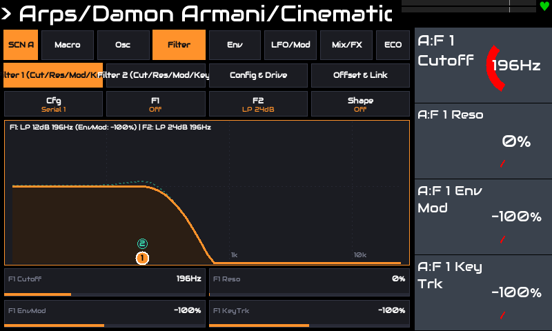
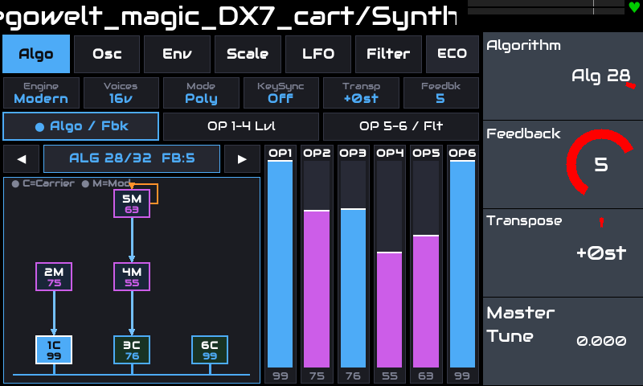
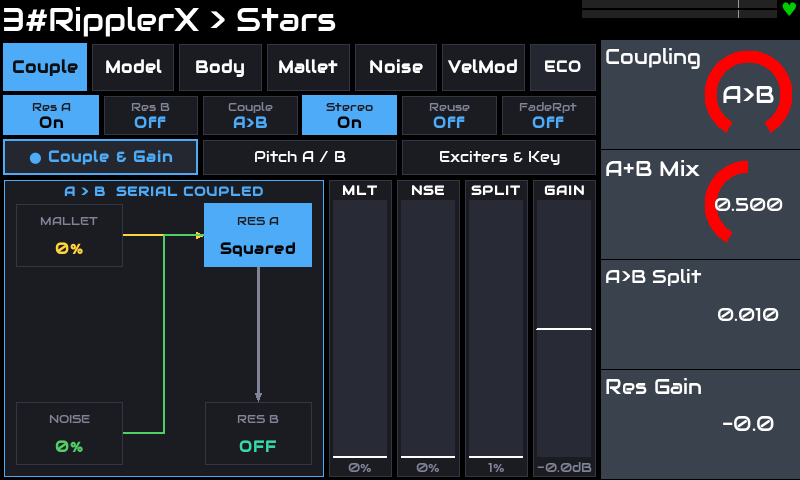
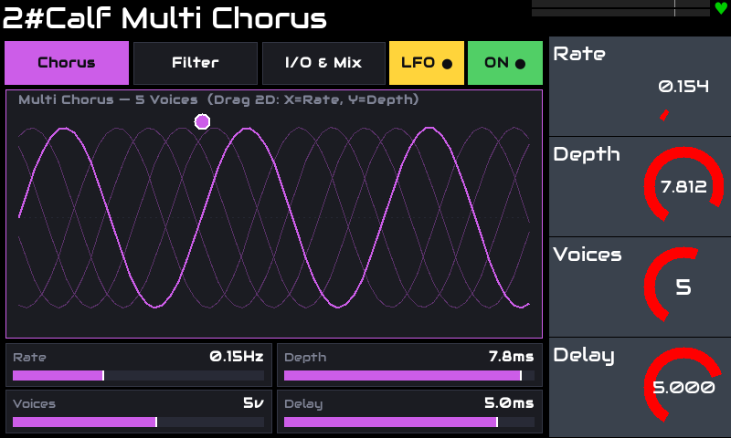
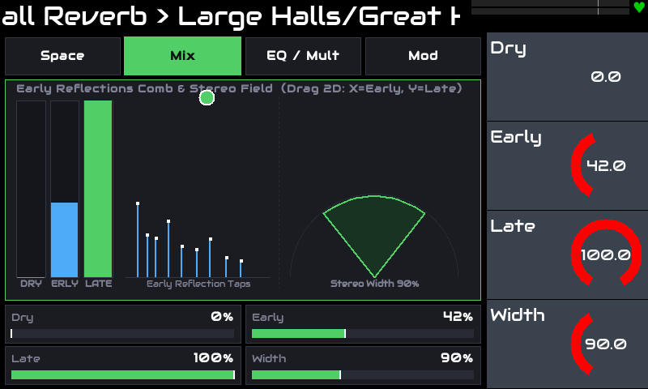
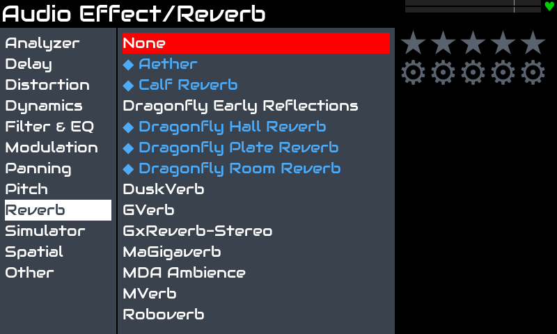

# UI Synths (`zynthian-ui-synths`)

**🇬🇧 English** | **🇷🇺 [Русский](README.ru.md)**

Custom touch-first workstation widgets for **Zynthian** (V5 800×480 & touchscreens) with dynamic 4-encoder binding, authentic DSP scales, live visualizations, and optional `zynthian-ui` patches.

---

## Screenshots

| Surge XT | Dexed |
| :---: | :---: |
|  |  |
| **RipplerX** | **Calf Multi Chorus** |
|  |  |
| **Dragonfly Hall Reverb** | **Menu Highlight** |
|  |  |

---

## Key Features

- **Touch-First UX (800×480)**: Large touch targets (`≥ 34–44 px`), comfortable spacing, smooth full-screen drag, and **double-tap reset** on sliders and 2D pads.
- **2-Way 4-Encoder Sync**: Switching tabs, sub-banks, oscillators, filters, or FX modules instantly rebinds Zynthian's 4 physical encoders; turning encoders or switching pages keeps the UI in sync.
- **Authentic DSP Scales & Live Visualizers**: Real units (`Hz`/`kHz`, `ms`/`s`, `dB`, semitones, tempo divisions), live LV2 output metering where available, filter Bode curves, ADSR graphs, transfer curves, and oscilloscopes.
- **`ECO` CPU Tamer**: One-tap polyphony/oversampling cap for heavy synths on Raspberry Pi with clean restore of preset values.
- **Unified Design System**: Consistent dark Zynthian palette, color-coded tabs, and CPU-friendly `~16 FPS` dirty-checked redraws.

---

## Included Synthesizers (10)

| Synth | Widget File | Highlights |
| --- | --- | --- |
| **Surge XT** | `zynthian_widget_surge_xt.py` | 6 tabs (`Macro`, `Osc`, `Filter`, `Env`, `LFO/Mod`, `Mix/FX`), Scene A/B, dual F1/F2 Bode curve, dynamic osc params, `ECO` tamer |
| **Monique** | `zynthian_widget_monique.py` | 6 tabs (`Morph`, `Osc/FM`, `Filter`, `Env/LFO`, `Arp/Seq`, `EQ/FX`), 4 morph faders + MFO, 3 parallel filters, 16-step seq, 7-band EQ |
| **Vitalium** | `zynthian_widget_vitalium.py` | 6 tabs (`Macro`, `Osc`, `Filter`, `Env`, `LFO`, `FX`), 3 oscs + sample, 3 filters (F1/F2/FX), 6 ENVs, 8 LFO/RND, 8 FX modules, `ECO` tamer |
| **Vaporizer2** | `zynthian_widget_vaporizer2.py` | 6 tabs (`Macro`, `Osc`, `Filter`, `Env`, `LFO/Arp`, `FX`), 16-slot Mod Matrix, 4× WT oscs + Sampler, 3× 62-model filters, 5 MSEGs, 3 FX busses, `ECO` tamer |
| **ZynAddSubFX** | `zynthian_widget_zynaddsubfx.py` | 6 tabs (`Main`, `Filter`, `Mod`, `Glide`, `Tone`, `Voice`), 2D Filter/Resonance, ModWheel & Velocity curves, Portamento, `ECO` tamer |
| **Dexed** | `zynthian_widget_dexed.py` | 6 tabs (`Algo`, `Osc`, `Env`, `Scale`, `LFO`, `Filter`), live 32-algorithm DX7 diagram, 6-OP mixer, 4-stage R1–4/L1–4 2D envelopes, `ECO` voice cap |
| **RipplerX** | `zynthian_widget_ripplerx.py` | 6 tabs (`Couple`, `Model`, `Body`, `Mallet`, `Noise`, `VelMod`), `A+B`/`A>B` signal flow, 12 acoustic models, 16 mallets, `ECO` partial cap |
| **Noize Mak3r** | `zynthian_widget_noize_mak3r.py` | 6 tabs (`Osc`, `Filter`, `Env`, `LFO`, `FX`, `Perf`), dual oscs + sub, 11 filter models, 2D ADSR + Free AD, 2 LFOs, Juno Chorus I/II + Reverb/Delay |
| **OB-Xf** | `zynthian_widget_ob-xf.py` | 6 tabs (`Osc`, `Filter`, `Env`, `LFO`, `Voices`, `Perf`), Oberheim dual VCOs + X-Mod, 2P morph + 4P/15 Xpander filters, 8-voice pan spread, `ECO` tamer |
| **Calf Organ** | `zynthian_widget_calf_organ.py` | 6 tabs (`Drawbars`, `Harmonic`, `Perc`, `Filter`, `Env`, `Vib/EQ`), 9 color-coded Hammond B3 drawbars + 4 registrations, 36 waveforms, FM perc, `ECO` voice cap |

---

## Included Audio Effects (23 widgets)

| Effect | Widget File(s) | Highlights |
| --- | --- | --- |
| **YK Chorus** | `zynthian_widget_yk_chorus.py` | Retro Juno-60 BBD Chorus buttons (`OFF` / `I` / `II` / `I+II`), live dual-LFO scope |
| **Calf Multi Chorus** | `zynthian_widget_calf_multi_chorus.py` | 3 tabs (`Chorus`, `Filter`, `I/O & Mix`), 8-voice phase LFO scope & dual bandpass 2D pads |
| **Aether** | `zynthian_widget_aether.py` | 4 tabs (`Mix & Space`, `Early`, `Late`, `EQ & Sat`), early taps + late tail + EQ curve |
| **Dragonfly Hall / Plate / Room** | `zynthian_widget_dragonfly_*_reverb.py` | Dedicated Hall, Plate, and Room reverb UIs with 2D `Size/Decay` pads, early taps & stereo width |
| **Calf Reverb** | `zynthian_widget_calf_reverb.py` | 3 tabs (`Space`, `EQ & Damp`, `Mix & I/O`), 6 room types, decay tail, EQ/damping & 2D Wet×Dry pad |
| **Shiroverb** | `zynthian_widget_shiroverb.py` | 2 tabs (`Shimmer`, `Space & Tone`), 1-tap pitch ratio pills (`-1 Oct`..`+1 Oct`), shimmer cascade visualizer |
| **Argotlunar2** | `zynthian_widget_argotlunar2.py` | 5 tabs (`Grains`, `Pitch`, `Filter`, `Env`, `Mix/Mod`) + `FREEZE`, live granular cloud |
| **TAL-Dub-3** | `zynthian_widget_tal-dub-3.py` | 3 tabs (`Delay`, `Filter`, `Dub Mix`) + `x2 L`/`x2 R`/`LIVE`, tempo-sync bar, echo tap timeline & feedback filter |
| **CHOWTapeModel** | `zynthian_widget_chowtapemodel.py` | 5 tabs (`Tape`, `Wow/Flt`, `Loss`, `Degrade`, `Tone/Comp`) + `ECO`, live B-H hysteresis loop & head-loss curve |
| **Calf Tape Simulator** | `zynthian_widget_calf_tape_simulator.py` | 3 tabs (`Tape`, `Filter`, `I/O`), animated reel-to-reel deck, head-bump curve & live stereo VU/clip meters |
| **Calf Saturator** | `zynthian_widget_calf_saturator.py` | 3 tabs (`Drive`, `Pre/Post`, `Tone & I/O`), live Tape↔Tube waveshaping transfer curve & Pre/Post EQ |
| **Calf Crusher** | `zynthian_widget_calf_crusher.py` | 3 tabs (`Crush`, `LFO`, `I/O & DC`), live quantized staircase bitcrusher scope |
| **Temper** | `zynthian_widget_temper.py` | 2 tabs (`Distort`, `Filter & Out`), live phase-distortion transfer curve & resonant filter 2D pad |
| **Luftikus** | `zynthian_widget_luftikus.py` | 2 tabs (`EQ Bands`, `Air & Master`), Maag EQ4 6-band draggable curve & dedicated 5-freq Air Band (`2.5`–`40 kHz`) |
| **Calf Sidechain Compressor** | `zynthian_widget_calf_sidechain_compressor.py` | 4 tabs (`Comp`, `Time`, `S/C EQ`, `S/C Route`) + `SC` Listen, live GR meter, Ducking Scope & dual-node S/C EQ |
| **Calf Transient Designer** | `zynthian_widget_calf_transient_designer.py` | 3 tabs (`Shape`, `Filter`, `I/O & Adv`) + `LISTEN`, dual 2D Attack/Release envelope & detector HP/LP filter |
| **Calf Stereo Tools** | `zynthian_widget_calf_stereo_tools.py` | 4 tabs (`Stereo`, `M/S`, `Matrix`, `I/O`), live goniometer vectorscope, 2D Mid/Side stage & 7-mode matrix |
| **x42-comp (Mono / Stereo)** | `zynthian_widget_x42-comp_-_dynamic_compressor_{mono,stereo}.py` | 2 tabs (`Comp`, `Time`) + `HOLD`, live LV2 RMS/Gain telemetry, DARC auto-makeup curve & rolling scope |
| **x42-dpl (Mono / Stereo)** | `zynthian_widget_x42-dpl_-_digital_peak_limiter_{mono,stereo}.py` | 2 tabs (`Limiter`, `Scope`) + `4x TRUE PEAK`, live brickwall ceiling curve, top-down GR meter & 2s peak scope |

---

## Installation

### Quick Install directly on Zynthian (recommended)

Open Zynthian's terminal (via SSH or Webconf → Interface → Terminal) and run:

```bash
# Widgets only:
curl -fsSL https://raw.githubusercontent.com/dmtry3/zynthian-ui-synths/main/install.sh | bash

# Widgets + optional Zynthian UI patches (menu ◆ badge & widget priority) + restart UI:
curl -fsSL https://raw.githubusercontent.com/dmtry3/zynthian-ui-synths/main/install.sh | bash -s -- --with-patches --restart
```

### Install from a local clone on Zynthian

```bash
git clone https://github.com/dmtry3/zynthian-ui-synths.git
cd zynthian-ui-synths
./install.sh --with-patches --restart
```

### Remote install from PC / Mac over SSH

```bash
git clone https://github.com/dmtry3/zynthian-ui-synths.git
cd zynthian-ui-synths

# Default remote host is root@zynthian.local (or specify your Zynthian IP):
./install.sh root@zynthian.local
./install.sh root@<zynthian-ip> --with-patches --restart
```

Widgets are installed to `/zynthian/zynthian-ui/zyngui/widgets_user/`.

### Uninstall

```bash
# Directly on Zynthian (removes only UI Synths widgets & reverts patches):
curl -fsSL https://raw.githubusercontent.com/dmtry3/zynthian-ui-synths/main/install.sh | bash -s -- --uninstall --restart

# Or from a cloned repo / remotely:
./install.sh --uninstall --restart
./install.sh root@<zynthian-ip> --uninstall --restart
```

---

## Zynthian UI Patches (`patches/`)

Optional patches for `/zynthian/zynthian-ui` (see [`patches/README.md`](patches/README.md) for details):

1. **`01-highlight-custom-widgets-in-menu.patch`** — marks engines/effects that have a widget in `widgets_user/` with a blue `◆ ` badge (`#4dabf7`) in Zynthian's engine selector menu.
2. **`02-prioritize-custom-gui-widget.patch`** — prioritizes `custom_gui_fpath` over built-in Zynthian mini-widgets (`filter`/`envelope`).
3. **`03-zynaddsubfx-custom-widget.patch`** — wires `zynthian_widget_zynaddsubfx.py` into `zynthian_engine_zynaddsubfx.py`.

```bash
# On Zynthian directly (auto-detected) or remotely via user@host:
./install.sh --check-patches               # check patch status
./install.sh --with-patches --restart      # apply patches & restart UI
./install.sh --revert-patches --restart    # revert patches (e.g. before updating Zynthian)
```
