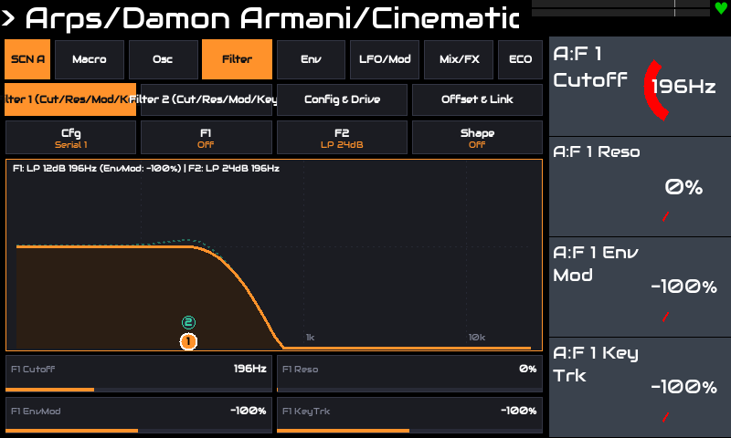
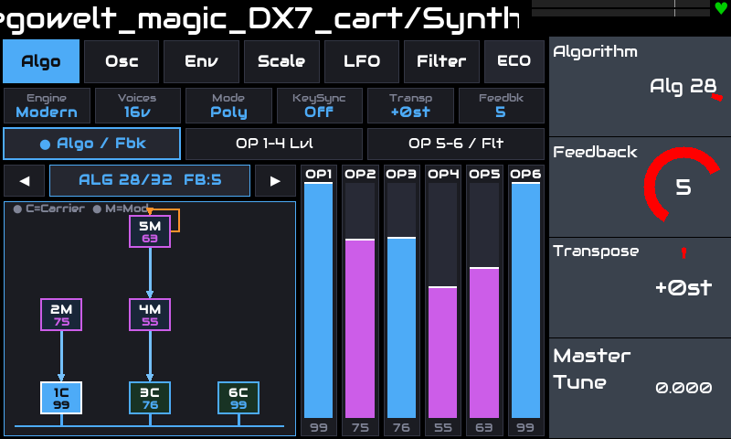
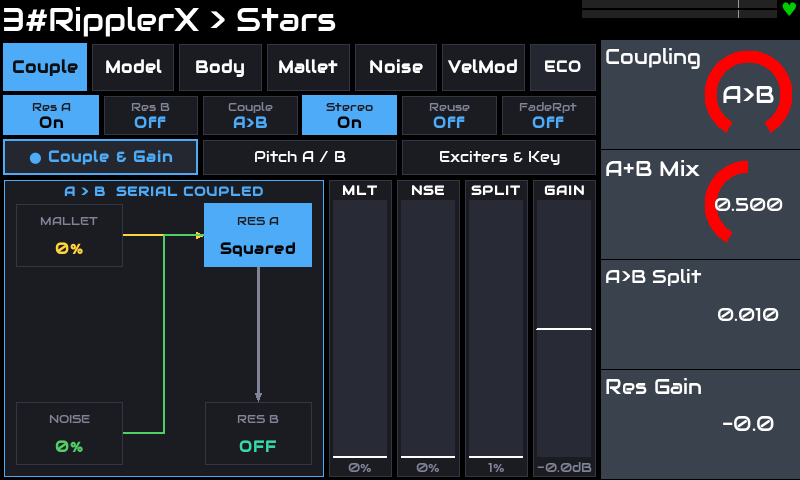
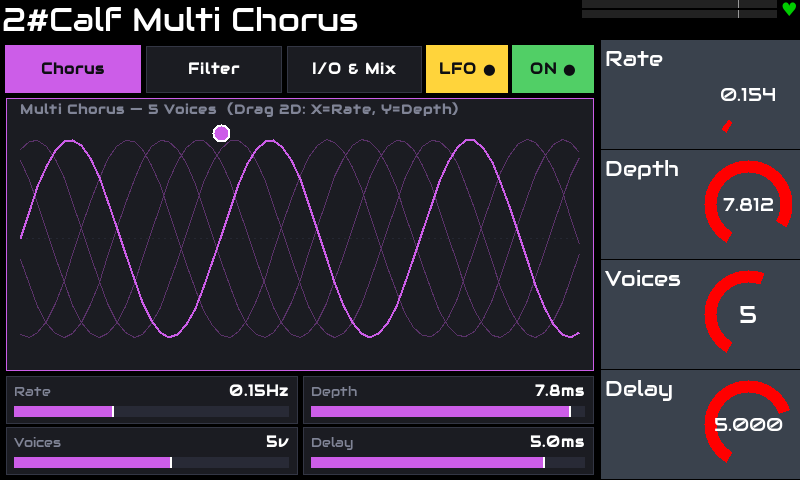
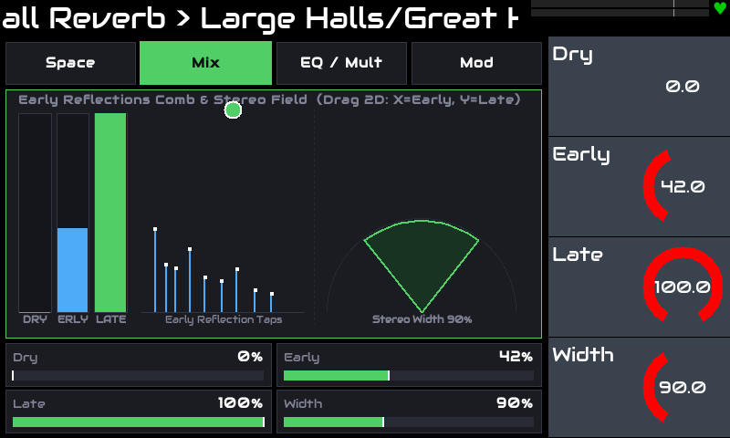
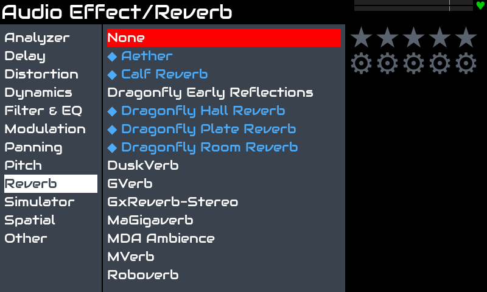

# UI Synths (`zynthian-ui-synths`)

**🇬🇧 [English](README.md)** | **🇷🇺 Русский**

Кастомные тачскрин-оболочки для **Zynthian** (V5 800×480 и сенсорные экраны) с динамической привязкой 4 физических энкодеров, реальными шкалами DSP, живой визуализацией и опциональными патчами для `zynthian-ui`.

---

## Скриншоты

| Surge XT (АЧХ фильтров F1/F2 + 2D-узлы) | Dexed (Диаграмма 32 алгоритмов DX7 + микшер 6 OP) |
| :---: | :---: |
|  |  |
| **RipplerX (Схема роутинга + фейдеры резонаторов)** | **Calf Multi Chorus (Осциллограф 5-голосного LFO)** |
|  |  |
| **Dragonfly Hall Reverb (Ранние отражения + стерео)** | **Патч подсветки в меню движков (`patches/`)** |
|  |  |

---

## Ключевые особенности

- **Touch-First UX (800×480)**: крупные элементы управления (`≥ 34–44 px`), комфортные отступы, плавное перетаскивание по всему экрану и **сброс двойным тапом** для слайдеров и 2D-пэдов.
- **Двусторонняя синхронизация с 4 энкодерами**: переключение вкладок, суб-банков, осцилляторов, фильтров и эффектов мгновенно перепривязывает 4 физических энкодера Zynthian; вращение энкодеров и смена страниц сразу обновляют графику.
- **Аутентичные шкалы DSP и живая визуализация**: реальные единицы (`Гц`/`кГц`, `мс`/`с`, `дБ`, полутона, доли такта), живые LV2-метры (где поддерживается движком), графики АЧХ фильтров, кривые ADSR, передаточные характеристики и осциллографы.
- **Кнопка `ECO` (CPU Tamer)**: ограничение полифонии и оверсэмплинга для тяжёлых синтезаторов на Raspberry Pi в одно касание с восстановлением настроек пресета.
- **Единый дизайн**: тёмная палитра Zynthian, цветовое кодирование вкладок и экономичная перерисовка `~16 FPS` с dirty-checking.

---

## Синтезаторы (10)

| Синтезатор | Файл виджета | Возможности |
| --- | --- | --- |
| **Surge XT** | `zynthian_widget_surge_xt.py` | 6 вкладок (`Macro`, `Osc`, `Filter`, `Env`, `LFO/Mod`, `Mix/FX`), Scene A/B, двойной график F1/F2, динамические параметры осцилляторов, `ECO` |
| **Monique** | `zynthian_widget_monique.py` | 6 вкладок (`Morph`, `Osc/FM`, `Filter`, `Env/LFO`, `Arp/Seq`, `EQ/FX`), 4 фейдера морфинга + MFO, 3 параллельных фильтра, 16-шаговый секвенсор, 7-полосный EQ |
| **Vitalium** | `zynthian_widget_vitalium.py` | 6 вкладок (`Macro`, `Osc`, `Filter`, `Env`, `LFO`, `FX`), 3 осц. + сэмплер, 3 фильтра (F1/F2/FX), 6 ENV, 8 LFO/RND, 8 FX-модулей, `ECO` |
| **Vaporizer2** | `zynthian_widget_vaporizer2.py` | 6 вкладок (`Macro`, `Osc`, `Filter`, `Env`, `LFO/Arp`, `FX`), матрица модуляции на 16 слотов, 4× WT осц. + сэмплер, 3× 62-модельных фильтра, 5 MSEG, 3 шины FX, `ECO` |
| **ZynAddSubFX** | `zynthian_widget_zynaddsubfx.py` | 6 вкладок (`Main`, `Filter`, `Mod`, `Glide`, `Tone`, `Voice`), 2D-пэд Filter/Resonance, кривые ModWheel и Velocity, Portamento, `ECO` |
| **Dexed** | `zynthian_widget_dexed.py` | 6 вкладок (`Algo`, `Osc`, `Env`, `Scale`, `LFO`, `Filter`), живая диаграмма 32 алгоритмов DX7, микшер 6 операторов, 2D-огибающие R1–4/L1–4, `ECO` |
| **RipplerX** | `zynthian_widget_ripplerx.py` | 6 вкладок (`Couple`, `Model`, `Body`, `Mallet`, `Noise`, `VelMod`), схема `A+B`/`A>B`, 12 акустических моделей, 16 молоточков, `ECO` |
| **Noize Mak3r** | `zynthian_widget_noize_mak3r.py` | 6 вкладок (`Osc`, `Filter`, `Env`, `LFO`, `FX`, `Perf`), 2 осц. + sub, 11 моделей фильтров, 2D ADSR + Free AD, 2 LFO, Juno Chorus I/II + Reverb/Delay |
| **OB-Xf** | `zynthian_widget_ob-xf.py` | 6 вкладок (`Osc`, `Filter`, `Env`, `LFO`, `Voices`, `Perf`), двойной VCO + X-Mod, морф-фильтр 2P + 4P/15 Xpander, панорамирование 8 голосов, `ECO` |
| **Calf Organ** | `zynthian_widget_calf_organ.py` | 6 вкладок (`Drawbars`, `Harmonic`, `Perc`, `Filter`, `Env`, `Vib/EQ`), 9 цветных регистров Hammond B3 + 4 пресета, 36 волн, FM-перкуссия, `ECO` |

---

## Аудиоэффекты (23 виджета)

| Эффект | Файл(ы) виджета | Возможности |
| --- | --- | --- |
| **YK Chorus** | `zynthian_widget_yk_chorus.py` | Кнопки ретро-хоруса Juno-60 (`OFF` / `I` / `II` / `I+II`), живой осциллограф двойного LFO |
| **Calf Multi Chorus** | `zynthian_widget_calf_multi_chorus.py` | 3 вкладки (`Chorus`, `Filter`, `I/O & Mix`), 8-голосный фазовый LFO и 2D-пэды полосовых фильтров |
| **Aether** | `zynthian_widget_aether.py` | 4 вкладки (`Mix & Space`, `Early`, `Late`, `EQ & Sat`), ранние отражения + поздний хвост + АЧХ EQ |
| **Dragonfly Hall / Plate / Room** | `zynthian_widget_dragonfly_*_reverb.py` | Отдельные оболочки для Hall, Plate и Room с 2D-пэдами `Size/Decay`, гребёнкой ранних отражений и шириной стерео |
| **Calf Reverb** | `zynthian_widget_calf_reverb.py` | 3 вкладки (`Space`, `EQ & Damp`, `Mix & I/O`), 6 типов комнат, хвост затухания, EQ/демпфирование и 2D-пэд Wet×Dry |
| **Shiroverb** | `zynthian_widget_shiroverb.py` | 2 вкладки (`Shimmer`, `Space & Tone`), кнопки питча шиммера (`-1 Oct`..`+1 Oct`), визуализация каскада шиммера |
| **Argotlunar2** | `zynthian_widget_argotlunar2.py` | 5 вкладок (`Grains`, `Pitch`, `Filter`, `Env`, `Mix/Mod`) + `FREEZE`, живое гранулярное облако |
| **TAL-Dub-3** | `zynthian_widget_tal-dub-3.py` | 3 вкладки (`Delay`, `Filter`, `Dub Mix`) + `x2 L`/`x2 R`/`LIVE`, панель синхронизации с темпом, таймлайн эхо и фильтр обратной связи |
| **CHOWTapeModel** | `zynthian_widget_chowtapemodel.py` | 5 вкладок (`Tape`, `Wow/Flt`, `Loss`, `Degrade`, `Tone/Comp`) + `ECO`, живая петля гистерезиса B-H и кривая потерь головки |
| **Calf Tape Simulator** | `zynthian_widget_calf_tape_simulator.py` | 3 вкладки (`Tape`, `Filter`, `I/O`), анимированные катушки, кривая head-bump и живые стерео VU/Clip-индикаторы |
| **Calf Saturator** | `zynthian_widget_calf_saturator.py` | 3 вкладки (`Drive`, `Pre/Post`, `Tone & I/O`), живая кривая насыщения Tape↔Tube и Pre/Post EQ |
| **Calf Crusher** | `zynthian_widget_calf_crusher.py` | 3 вкладки (`Crush`, `LFO`, `I/O & DC`), живой график ступенчатого квантования биткрашера |
| **Temper** | `zynthian_widget_temper.py` | 2 вкладки (`Distort`, `Filter & Out`), кривая фазового дисторшна и 2D-пэд резонансного фильтра |
| **Luftikus** | `zynthian_widget_luftikus.py` | 2 вкладки (`EQ Bands`, `Air & Master`), 6-полосная кривая Maag EQ4 с перетаскиваемыми узлами и Air Band (`2.5`–`40 кГц`) |
| **Calf Sidechain Compressor** | `zynthian_widget_calf_sidechain_compressor.py` | 4 вкладки (`Comp`, `Time`, `S/C EQ`, `S/C Route`) + `SC` Listen, живой GR-метр, Ducking Scope и двухузловой S/C EQ |
| **Calf Transient Designer** | `zynthian_widget_calf_transient_designer.py` | 3 вкладки (`Shape`, `Filter`, `I/O & Adv`) + `LISTEN`, два 2D-узла Attack/Release и детекторный HP/LP фильтр |
| **Calf Stereo Tools** | `zynthian_widget_calf_stereo_tools.py` | 4 вкладки (`Stereo`, `M/S`, `Matrix`, `I/O`), живой гониометр, 2D-сцена Mid/Side и 7-режимная матрица |
| **x42-comp (Mono / Stereo)** | `zynthian_widget_x42-comp_-_dynamic_compressor_{mono,stereo}.py` | 2 вкладки (`Comp`, `Time`) + `HOLD`, живая телеметрия RMS/Gain, кривая DARC с auto-makeup и скользящий осциллограф |
| **x42-dpl (Mono / Stereo)** | `zynthian_widget_x42-dpl_-_digital_peak_limiter_{mono,stereo}.py` | 2 вкладки (`Limiter`, `Scope`) + `4x TRUE PEAK`, brickwall-кривая лимитера, GR-метр сверху вниз и 2-секундный осциллограф |

---

## Установка

Хост Zynthian по умолчанию: `root@10.0.99.99`

```bash
./install.sh
# или указать другой адрес:
./install.sh root@<zynthian-ip>
```

Виджеты копируются в `/zynthian/zynthian-ui/zyngui/widgets_user/`.

---

## Патчи для Zynthian UI (`patches/`)

Опциональные патчи для `/zynthian/zynthian-ui` (подробнее в [`patches/README.md`](patches/README.md)):

1. **`01-highlight-custom-widgets-in-menu.patch`** — выделяет синты и эффекты, у которых есть кастомный виджет в `widgets_user/`, префиксом `◆ ` и голубым цветом (`#4dabf7`) в списке выбора движков Zynthian.
2. **`02-prioritize-custom-gui-widget.patch`** — даёт `custom_gui_fpath` приоритет над встроенными мини-виджетами Zynthian (`filter`/`envelope`).
3. **`03-zynaddsubfx-custom-widget.patch`** — подключает `zynthian_widget_zynaddsubfx.py` в `zynthian_engine_zynaddsubfx.py`.

```bash
./patches/apply_patches.sh --check   # проверить статус патчей на Zynthian
./patches/apply_patches.sh           # применить патчи (идемпотентно)
./patches/apply_patches.sh --revert  # откатить патчи (например, перед обновлением Zynthian)
```

После применения или отката перезапустите интерфейс Zynthian:

```bash
ssh root@10.0.99.99 systemctl restart zynthian
```
